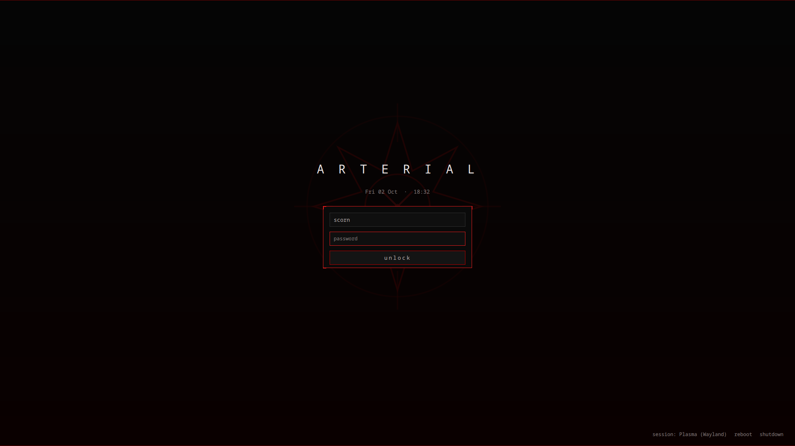

# Arterial — SDDM Login Theme

A black / dark-grey / arterial-red SDDM login screen that matches the
[Arterial KDE suite](https://github.com/numbpill3d/arterial-kde). Near-black field with a
faint red vignette, a pulsing eight-point sigil watermark, an `ARTERIAL` wordmark, and a
red-edged login plate with bright corner brackets. Ghost-grey mono text; `†` password dots.

## Requirements

SDDM with the **Qt6** greeter (`sddm-greeter-qt6`). Font: Noto Sans Mono (any mono works).

## Install

    git clone https://github.com/numbpill3d/arterial-sddm
    cd arterial-sddm
    ./install.sh          # copies to /usr/share/sddm/themes/arterial and sets it current

Or manually:

    sudo cp -r . /usr/share/sddm/themes/arterial
    printf '[Theme]\nCurrent=arterial\n' | sudo tee /etc/sddm.conf.d/zz-arterial.conf

## Preview without logging out

    sddm-greeter-qt6 --test-mode --theme /usr/share/sddm/themes/arterial

## Files

- `Main.qml` — the greeter (pure QtQuick, no extra imports)
- `theme.conf` — background colour
- `metadata.desktop` — theme metadata
- `assets/sigil.svg` — the Arterial sigil

By splicer scorn (voidrane). GPL-3.0-or-later.
